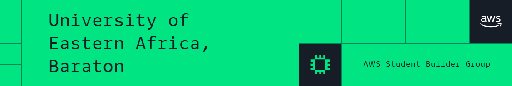
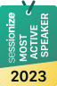
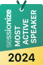
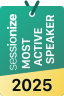

<!-- _class: cover -->
<!-- _paginate: false -->

<div class="cover-layout">
  <div class="cover-copy">
    <p class="eyebrow">AWS STUDENT BUILDER GROUP · UEAB</p>
    <h1>Ship a .NET app<br>to AWS without suffering</h1>
    <p class="subtitle">Build a shop. Read one trace.<br>Deploy with .NET Aspire and Docker Compose.</p>
    <p class="date">16 November 2026 · 17:00 UTC</p>
  </div>
  
</div>


<!--
TIME: 0:00 – 0:45

Welcome everyone. I am joining from the Canary Islands. Thank you to the AWS Student Builder Group for having me.
Today we will build a tiny shop, use the Aspire dashboard, and ship the same app to AWS without a complicated cloud setup.
-->

---

<!-- _class: bio -->

## About the speaker

<div class="bio-layout">
  
  <div class="bio-copy">
    <p class="eyebrow">YOUR HOST</p>
    <h1>Emiliano Montesdeoca</h1>
    <p class="bio-role">Cloud Development Team Lead · Intelequia</p>
    <ul class="bio-facts">
      <li>Microsoft MVP · Developer Technologies since 2022</li>
      <li>Sessionize speaker · .NET and cloud community events</li>
      <li>Most Active Speaker · 2023, 2024, 2025</li>
    </ul>
    <div class="bio-badges">
      
      
      
      
    </div>
  </div>
</div>

<!--
TIME: 0:45 – 2:15

Introduce yourself briefly: you started as a .NET developer and now lead cloud development at Intelequia.
Mention the Microsoft MVP award and community speaking, then move on.
-->

---

## The promise

<p class="big">No AWS experience needed.</p>

<div class="cards">
  <div class="card">
    <h3>Build</h3>
    <p>A tiny online shop with three services.</p>
  </div>
  <div class="card">
    <h3>Understand</h3>
    <p>Use the Aspire dashboard to follow one order.</p>
  </div>
  <div class="card">
    <h3>Deploy</h3>
    <p>Run the same app on AWS with Docker Compose.</p>
  </div>
</div>

<!--
TIME: 2:15 – 3:15

Set the level: a web app is enough background. Explain any cloud word when it first appears.
The goal is not to learn all of AWS today. It is to see the same small system run in two places.
-->

---

## Our tiny app

<div class="flow">
  <div class="node"><strong>Shop</strong><br><span class="small">place an order</span></div>
  <div class="arrow">-&gt;</div>
  <div class="node"><strong>API</strong><br><span class="small">accepts it</span></div>
  <div class="arrow">-&gt;</div>
  <div class="node"><strong>Redis</strong><br><span class="small">holds the order</span></div>
  <div class="arrow">-&gt;</div>
  <div class="node"><strong>Worker</strong><br><span class="small">processes it</span></div>
</div>

<p class="callout">One order. Three services. One thing to watch in the dashboard.</p>

<!--
TIME: 3:15 – 5:00

The shop is just a web page. The API receives the order. Redis is a small in-memory service that holds it.
The worker is a separate process that picks it up and marks it processed. No database lecture today.
-->

---

## What is .NET Aspire?

<p class="big">Open-source tooling for building, running, and observing distributed .NET apps.</p>

<div class="cols">
  <div class="card">
    <h3>Distributed app</h3>
    <p>An app made of parts such as an API, a worker, and a cache.</p>
  </div>
  <div class="card">
    <h3>Developer workflow</h3>
    <p>A consistent way to start the whole system and understand what it is doing.</p>
  </div>
</div>

<p class="small">Aspire is not a web framework and it does not replace Docker or AWS.</p>

<!--
TIME: 5:00 – 7:30

Explain Aspire as tooling around the app, not a new way to write the API.
It helps coordinate the pieces and makes the whole system easier to run and observe.
-->

---

## What Aspire gives you

<div class="cards four">
  <div class="card">
    <h3>One app model</h3>
    <p>Describe services and how they depend on each other.</p>
  </div>
  <div class="card">
    <h3>Local orchestration</h3>
    <p>Start the API, Redis, and worker together.</p>
  </div>
  <div class="card">
    <h3>Useful defaults</h3>
    <p>Service discovery, health checks, and telemetry.</p>
  </div>
  <div class="card">
    <h3>Deployment targets</h3>
    <p>Publish this demo as Docker Compose.</p>
  </div>
</div>

<p class="callout">One workflow for the whole app, from local development to deployment artifacts.</p>

<!--
TIME: 7:30 – 10:00

Introduce the features at a high level. Aspire coordinates services, supplies shared defaults,
and can publish the app model to a deployment target. No code walkthrough on this slide.
-->

---

## The Aspire dashboard

<p class="big">One local window into the whole application.</p>

<div class="cards four">
  <div class="card">
    <h3>Resources</h3>
    <p>Running state, health, dependencies, and endpoints.</p>
  </div>
  <div class="card">
    <h3>Logs</h3>
    <p>Search and filter messages across services.</p>
  </div>
  <div class="card">
    <h3>Traces</h3>
    <p>Follow one request through the API, cache, and worker.</p>
  </div>
  <div class="card">
    <h3>Metrics</h3>
    <p>See runtime and application measurements over time.</p>
  </div>
</div>

<p class="callout">The same dashboard gives you a view of the whole system, not just one project.</p>

<!--
TIME: 10:00 – 12:00

Introduce the four areas: resources, logs, traces, and metrics.
The live demo will use the resource list and one trace.
-->

---

<!-- _class: demo -->

## Start the shop

```powershell
cd src
aspire run
```

<p class="big">Open the dashboard. Wait for the resources to turn green.</p>

<p class="muted">Then open the API link and place one order.</p>

<!--
TIME: 12:00 – 16:00

Start the app. In the dashboard show cache, api, and worker.
Open the API endpoint and place a cacao order. The first run may pull images, so pre-run it before the talk.
If Docker is not running or the demo stalls, switch to the recording and keep going.
-->

## Follow one order

<div class="flow">
  <div class="node"><strong>POST</strong><br><span class="small">/orders</span></div>
  <div class="arrow">-&gt;</div>
  <div class="node"><strong>API</strong><br><span class="small">saves it</span></div>
  <div class="arrow">-&gt;</div>
  <div class="node"><strong>Redis</strong><br><span class="small">queues it</span></div>
  <div class="arrow">-&gt;</div>
  <div class="node"><strong>Worker</strong><br><span class="small">marks it done</span></div>
</div>

<p class="callout">The trace answers one simple question: what happened to my order?</p>

<!--
TIME: 16:00 – 18:30

Show one trace, not every span. Start at POST /orders and point to the worker finishing the order.
The important lesson is that traces connect work across processes.
-->

---

## Aspire gives us Docker Compose

```powershell
aspire publish
```

<div class="cols">
  <div class="card">
    <h3>Publish</h3>
    <p>Creates the Compose file and its environment template.</p>
  </div>
  <div class="card">
    <h3>Deploy</h3>
    <p>Builds the images and starts the Compose services.</p>
  </div>
</div>

<p class="small">Generated output: <code>src/AppHost/aspire-output/docker-compose.yaml</code></p>

<!--
TIME: 18:30 – 21:00

Aspire has a Docker Compose deployment target. Publish writes the Compose artifacts.
Deploy prepares the values, builds the images, and runs docker compose.
No AWS-specific Aspire package and no hand-written CloudFormation.
-->

---

## AWS, the simple version

<div class="cols">
  <div class="card">
    <h3>EC2</h3>
    <p>A Linux computer rented from AWS.</p>
    <p>Docker and Compose run on that computer.</p>
  </div>
  <div class="card">
    <h3>Our app</h3>
    <p>Compose starts the API, Redis, and worker together.</p>
    <p>The browser reaches the API on port 8080.</p>
  </div>
</div>

<p class="big">One machine. One Compose deployment.</p>

<!--
TIME: 21:00 – 23:00

Explain EC2 as a rented Linux computer. This is the simplest way to run a Compose file in AWS.
We are intentionally not using ECS or Fargate in this beginner demo.
-->

---

## Keep the network simple

<div class="cards">
  <div class="card">
    <h3>SSH · 22</h3>
    <p>Allow only your own IP.</p>
  </div>
  <div class="card">
    <h3>Shop · 8080</h3>
    <p>Allow browser traffic for the demo.</p>
  </div>
  <div class="card">
    <h3>Redis</h3>
    <p>Keep it inside the Compose network.</p>
  </div>
</div>

<p class="small">This is a demo setup, not a production security design.</p>

<!--
TIME: 23:00 – 25:00

The AWS security group is the virtual firewall. Open SSH only to the presenter's IP and the shop port for viewers.
Do not expose Redis or the worker.
-->

---

## Point Aspire at the EC2 machine

```powershell
docker context create cacao-ec2 --docker "host=ssh://ubuntu@<EC2-PUBLIC-DNS>"
docker context use cacao-ec2

cd src
aspire deploy --environment production
```

<p class="callout">A Docker context tells Docker to use the EC2 machine over SSH.</p>

<!--
TIME: 25:00 – 28:30

The EC2 instance is prepared before the talk. The key must already work with ssh ubuntu@host.
Create the Docker context once, select it, then Aspire deploys the Compose app to that Docker host.
The deployment can take a few minutes. Start it live and have a recording ready.
-->

---

<!-- _class: demo -->

## The same shop, now on AWS

1. Open <code>http://&lt;EC2-PUBLIC-IP&gt;:8080</code>.
2. Place an order.
3. Check that the order becomes <code>processed</code>.
4. See the containers with <code>docker --context cacao-ec2 ps</code>.

<p class="big">Same app. New machine.</p>

<!--
TIME: 28:30 – 33:00

Show the endpoint, submit one order, and confirm the worker processed it.
Use docker --context cacao-ec2 ps to show the three containers. Do not spend time navigating the AWS console.
-->

---

## Simple on purpose

<div class="cols">
  <div class="card">
    <h3>What we get</h3>
    <p>A clear local workflow and a small AWS demo.</p>
  </div>
  <div class="card">
    <h3>What we do not get</h3>
    <p>No autoscaling, managed Redis, load balancer, or high availability.</p>
  </div>
</div>

<p class="callout">For production, choose a managed deployment target. This talk is about understanding the pieces first.</p>

<!--
TIME: 33:00 – 36:00

Be honest: a single EC2 instance is not Fargate and is not highly available.
It is the simplest place to run this Compose file and learn how the pieces connect.
-->

---

## Clean up the demo

```powershell
docker context use cacao-ec2
cd src
aspire destroy --environment production

docker context use default
```

<p class="big">Then terminate the EC2 instance.</p>
<p class="small">Deleting containers does not stop the EC2 bill.</p>

<!--
TIME: 36:00 – 37:30

Aspire destroy removes the Compose deployment. Switch back to the local Docker context.
Then terminate the EC2 instance in AWS. Set a budget alert before the first deployment.
-->

---

## Three things to remember

1. **Aspire** helps describe and run a multi-service app locally.
2. **The dashboard** helps us see what happened to one request.
3. **Docker Compose** can run the same services on an AWS EC2 machine.

<p class="big">Start small. Make the whole system work.</p>

<!--
TIME: 37:30 – 40:00

Recap the three steps. Invite questions. If asked about Fargate, explain that it needs an ECS deployment model;
we chose EC2 because it runs Compose directly and keeps today's demo beginner-friendly.
-->

---

<!-- _class: section -->
<!-- _paginate: false -->

# Questions?

<p>Thank you · 17:00 UTC · AWS Student Builder Group UEAB</p>

<!--
TIME: 40:00 – 45:00

Questions. If needed, use the backup slides and links in the README.
-->
